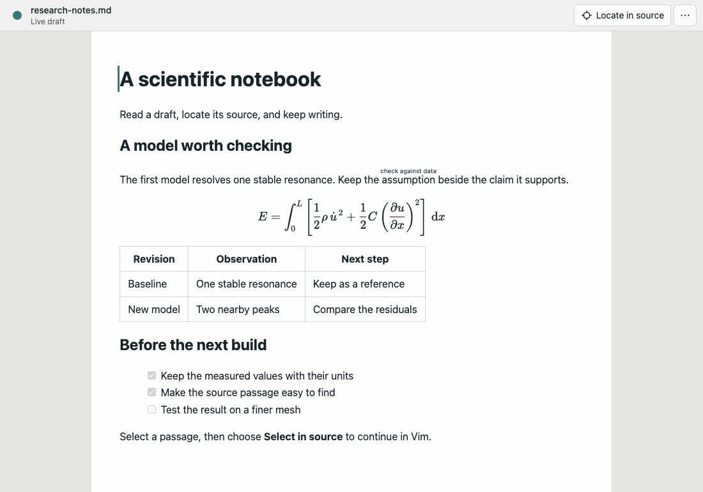

# WebPreview

**A unified preview interface for Markdown and LaTeX in Vim.**

Read your draft in the browser, locate or select its source, and keep editing.
The editing Vim owns the preview session: detaching a terminal multiplexer keeps
it alive; exiting Vim ends it.



Live draft → select in source → compiled TeX → Changes → search.
Static screenshots: [Markdown](doc/preview.png) · [TeX Changes](doc/changes.png).

## Install

With [vim-plug](https://github.com/junegunn/vim-plug), add `Plug 'BaksiLi/webpreview.vim'`, then run `:PlugInstall`.

With Vim's native packages, run `git clone https://github.com/BaksiLi/webpreview.vim.git ~/.vim/pack/plugins/start/webpreview.vim`.

Requires Vim 8.2+ with jobs, channels and timers, Python 3.9+, and
`filetype plugin on`. Browser libraries and fonts ship locally; no Node runtime
or pip installation is needed.

## Use

| Command | Action |
| --- | --- |
| `:WebPreview` | Open or reuse the current document's preview |
| `:WebPreviewChanges [baseline]` | Compare saved TeX source with a snapshot or Git ref |
| `:WebPreviewInquiry` | Open Cogitatum's semantic preview for inquiry fences |
| `:WebPreviewStop` | Stop previews for the current document type |

No mappings are installed. Choose your own, for example:

```vim
nnoremap <leader>p <Cmd>WebPreview<CR>
```

| Document | Preview |
| --- | --- |
| Markdown | Live buffer, including unsaved edits; math, tables, footnotes and Inline Annotation |
| LaTeX | Compiled PDF through PDF.js; SyncTeX navigation and latexdiff comparisons |
| Cogitatum | Optional vim-cogitatum integration; its terminal Reading/Map remain available |

TeX navigation needs SyncTeX. Comparisons additionally use `latexdiff`, `latexmk`
and the project's TeX engine. Cogitatum needs its own host plugin.

This is an early 0.x package. Browser checks cover Chromium and WebKit on macOS
and Linux CI, including narrow/touch layouts. Native Windows and physical
iOS/Termius have not been verified. Neovim is not currently supported.

TeX opens the existing PDF discovered through VimTeX, or beside the source.
It never saves or compiles the manuscript. Markdown sends the current buffer
without saving it. Your editor configuration owns saving, conflicts and builds.

Use **Locate in source** to choose a passage. Selecting browser text offers
**Select in source**; Vim enters Visual only for a unique literal source match.
Source jumps wait while you type or select. Dirty buffers are preserved.

PDF offers Original/Changes views, search, continuous Fit and optional following.
Markdown retains native browser Find, refreshes without losing reading position,
and pauses updates during text selection. Relative note links reuse its session.
Cogitatum currently retains its own browser UI and transport.

For `paper.tex`, a source-adjacent `paper.base.tex` is detected automatically.
Use `paper.review-base` for a Git ref or a relative path to a multi-file baseline.
Generated diff TeX stays private. See [Changes and baseline conventions](doc/changes.md).

## Configure

Set options before loading the plugin:

```vim
let g:webpreview_browser = 'Firefox'          " Optional local browser
let g:webpreview_host = 'preview.example'    " Optional private relay hostname
```

The default host is `127.0.0.1`; the listener always stays on loopback behind a
session token. SSH/mobile sessions show the URL instead of opening a browser on
the server. Configure a private relay or forward that loopback port locally.
Keep real hostnames and session URLs in local configuration.

`:help webpreview` documents commands, options and Vim integration hooks.
The Python CLI is also available: `python3 bin/webpreview --pdf /path/paper.pdf`.
`pip install .` installs the optional CLI, not the Vim plugin.

## Extend and develop

The default Markdown engine is remark/MDAST; markdown-it is an optional build
profile. Extensions use each engine's native API. Inline Annotation is both
the default extension and a working example. Build tools are needed only when
changing bundled libraries or adding extensions.

- [Engine profiles and extensions](doc/extensions.md)
- [Product boundaries and code layout](doc/architecture.md)
- [Editor JSON/HTTP protocol](doc/editor-protocol.md)
- [Development, asset rebuilding and release preparation](CONTRIBUTING.md)
- [Test scope and upstream fixtures](doc/testing.md)
- [Third-party notices](THIRD_PARTY.md)

Raw author HTML stays literal, remote resources do not load automatically,
and diagram fences remain code. Markdown images and linked notes stay within
the open document's folder. Inline Cogitatum rendering, automatic TOC and diagram
integrations are not supplied. These boundaries keep the reading-to-source
workflow predictable.

## Related

WebPreview is one of a small family of Vim plugins for writing: [MdToc.vim](https://github.com/BaksiLi/mdtoc.vim), [WebPreview.vim](https://github.com/BaksiLi/webpreview.vim) and [TeXinsitu.vim](https://github.com/BaksiLi/texinsitu.vim). Each works on its own. They were developed together in [Onesimus Vim](https://github.com/BaksiLi/Onesimus), a Vim distribution for scientific writing, which shows them combined.
