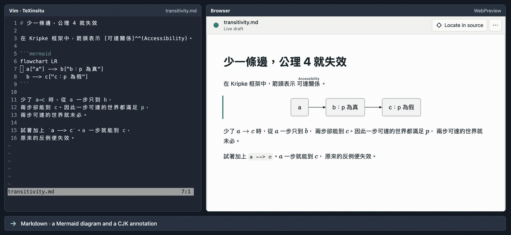
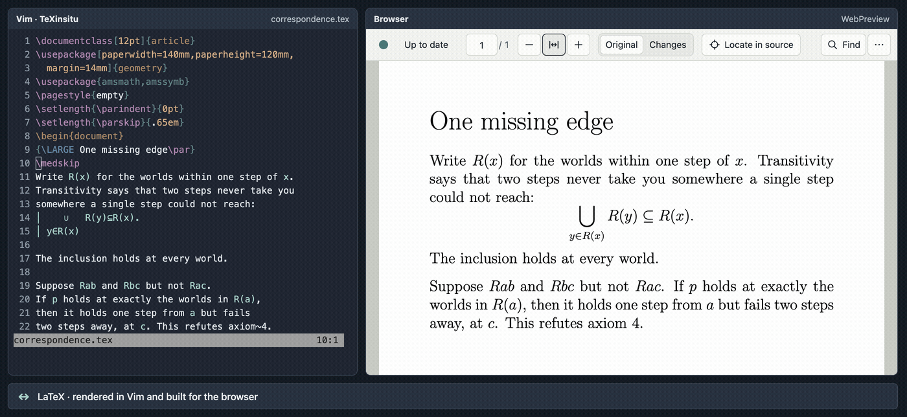
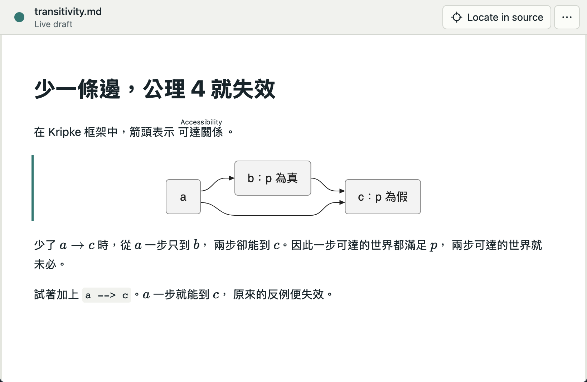
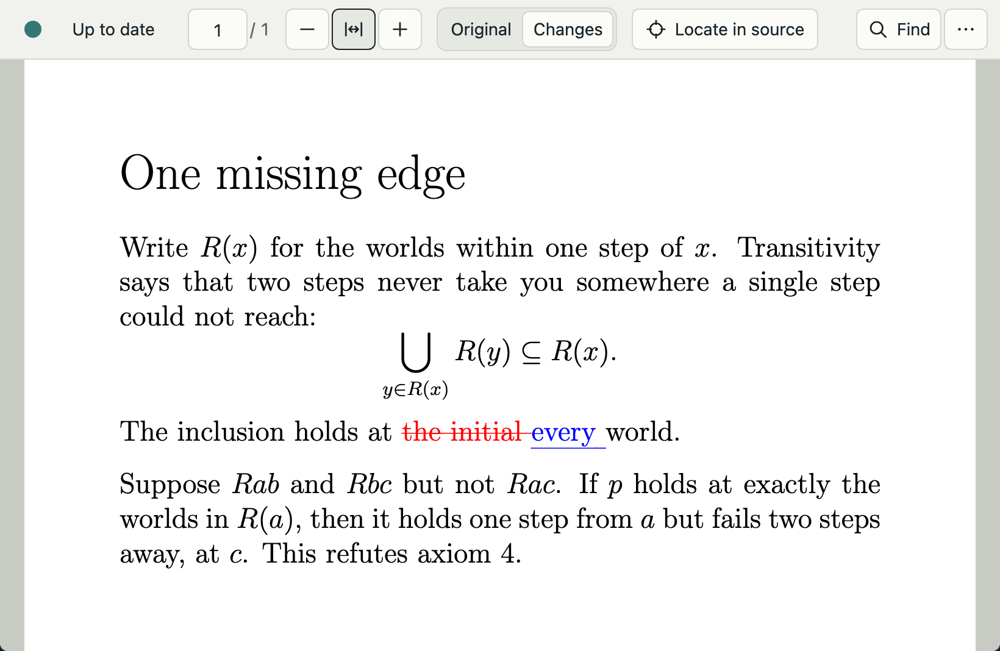
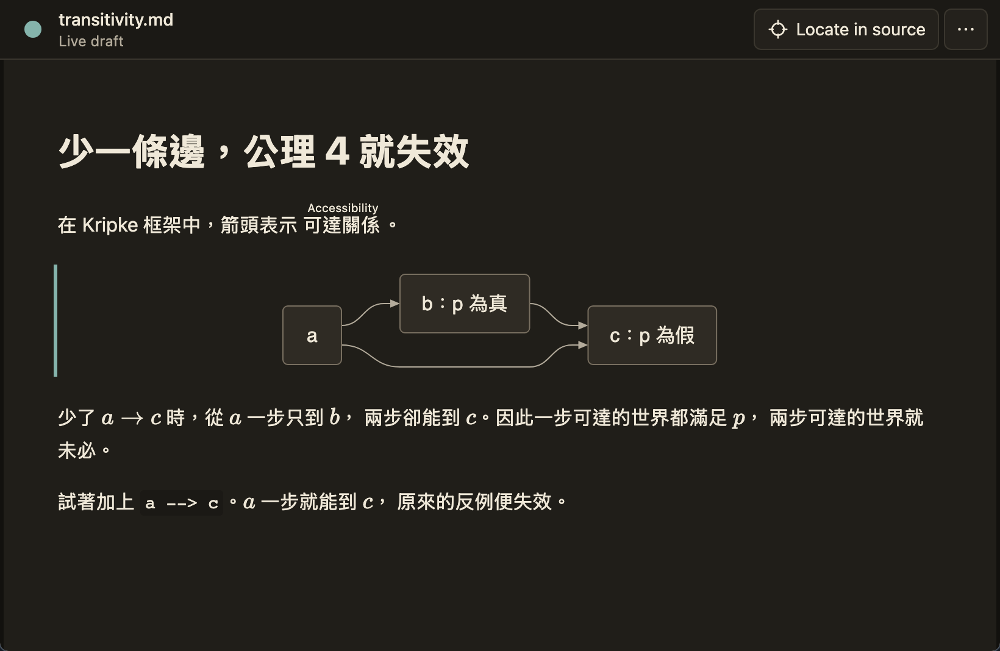

# WebPreview.vim

**Live Markdown and LaTeX preview for Vim, in your browser.**

Edit Markdown beside its live draft, or read a compiled LaTeX PDF with SyncTeX
and latexdiff. Jump between Vim and the browser in either direction. The preview
stays open when you detach from tmux or Zellij and ends when you quit Vim.





*Terminal Vim with optional [TeXinsitu](https://github.com/BaksiLi/texinsitu.vim)
on the left. Try the [Markdown draft](doc/examples/transitivity.md) or the
[LaTeX source](doc/examples/correspondence.tex) and its
[baseline](doc/examples/correspondence.base.tex).*

<details>
<summary>Screenshots · Markdown, TeX Changes and dark mode</summary>







</details>

## Install

With [vim-plug](https://github.com/junegunn/vim-plug), add `Plug 'BaksiLi/webpreview.vim'`, then run `:PlugInstall`.

With Vim's native packages, run `git clone https://github.com/BaksiLi/webpreview.vim.git ~/.vim/pack/plugins/start/webpreview.vim`.

Requires Vim 8.2+ with jobs, channels and timers, Python 3.9+, and
`filetype plugin on`. Browser libraries and fonts ship locally; no Node runtime
or pip installation is needed. See [tested platforms](doc/testing.md).

## Use

| Command | Action |
| --- | --- |
| `:WebPreview` | Open or reuse the current document's preview |
| `:WebPreviewChanges [baseline]` | Compare saved TeX source with a snapshot or Git ref |
| `:WebPreviewInquiry` | Open Cogitatum's semantic preview for inquiry fences |
| `:WebPreviewStop` | Stop previews for the current document type |

No mappings are installed. Choose your own, for example:

```vim
nnoremap <leader>p <Cmd>WebPreview<CR>
```

| Document | Preview |
| --- | --- |
| Markdown | Live buffer, including unsaved edits; math, tables, footnotes, Inline Annotation and Mermaid diagrams |
| LaTeX | Compiled PDF through PDF.js; SyncTeX navigation and latexdiff comparisons |
| Cogitatum | Optional vim-cogitatum integration; its terminal Reading/Map remain available |

- **Markdown** previews the unsaved buffer, preserves reading position and
  pauses refresh while you select text. Relative note links reuse the session.
- **LaTeX** previews the existing PDF from VimTeX or beside the source.
  SyncTeX links back to Vim. The PDF reader offers search, Fit and Original/Changes.
  Comparisons use `latexdiff`, `latexmk` and your TeX engine, and can pick up
  `paper.base.tex` beside `paper.tex`. See [baseline conventions](doc/changes.md).
- **Locate in source** takes you to a passage. **Select in source** enters
  Vim Visual mode when the selected text matches a unique source fragment.
  Jumps wait while you're editing in Insert or Visual mode.

Inline Annotation ships with Markdown. Write
`[可達關係]^^(Accessibility)` to place the gloss above the phrase.
Selecting the whole annotation in the browser recovers the markup in Vim.


Mermaid fences render locally with Pele. **Locate in source** on a diagram
returns to its fence.

Choose System, Light or Dark in **More options**. PDF pages keep their printed
colours. Your Vim setup owns saving and builds. Cogitatum uses its own host
plugin for semantic preview. For the full command reference, see `:help webpreview`.

## Configure

Set options before loading the plugin:

```vim
let g:webpreview_browser = 'Firefox'       " Optional local browser
let g:webpreview_host = 'preview.example'   " Optional private relay hostname
```

WebPreview listens on `127.0.0.1` and prints a tokenized URL in remote Vim
sessions. Keep the token path intact when opening it from another device.

- **SSH forwarding** works over an ordinary SSH connection or one over
  Tailscale. Forward the port Vim reports on the remote machine to a local
  port, then open the URL with that local port.
- **Private relay** can use [Surge Ponte](https://manual.nssurge.com/features/ponte.html)
  or [Tailscale Serve](https://tailscale.com/docs/reference/tailscale-cli/serve).
  With Ponte, set `g:webpreview_host` to your device's Ponte hostname. With
  Serve, proxy the reported loopback port and open Serve's private URL with
  the same token path. If the proxy forwards its own host name, set
  `g:webpreview_host` to that name in Vim. Keep device names and session URLs local.

`:help webpreview` documents commands, options and Vim integration hooks.
The Python CLI is also available: `python3 bin/webpreview --pdf /path/paper.pdf`.
`pip install .` installs the optional CLI, not the Vim plugin.

## Extend and develop

The default Markdown engine is remark/MDAST; markdown-it is an optional build
profile. Extensions use each engine's native API. Inline Annotation and Pele
are bundled examples. Build tools are needed only when changing bundled
libraries or adding extensions.

- [Engine profiles and extensions](doc/extensions.md)
- [Product boundaries and code layout](doc/architecture.md)
- [Editor JSON/HTTP protocol](doc/editor-protocol.md)
- [Development, asset rebuilding and release preparation](CONTRIBUTING.md)
- [Test scope and upstream fixtures](doc/testing.md)
- [Third-party notices](THIRD_PARTY.md)

Raw author HTML stays literal and remote resources do not load automatically.
Markdown images and linked notes stay within the open document's folder.
Inline Cogitatum rendering and automatic TOC are outside the Markdown reader.

## Related

Companion plugins: [MdToc.vim](https://github.com/BaksiLi/mdtoc.vim) for Markdown tables of contents and [TeXinsitu.vim](https://github.com/BaksiLi/texinsitu.vim) for TeX math rendered in Vim. [Onesimus Vim](https://github.com/BaksiLi/Onesimus), a Vim distribution for scientific writing, shows them working together.
